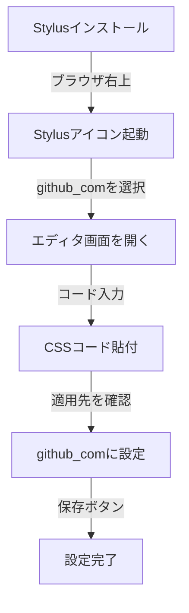
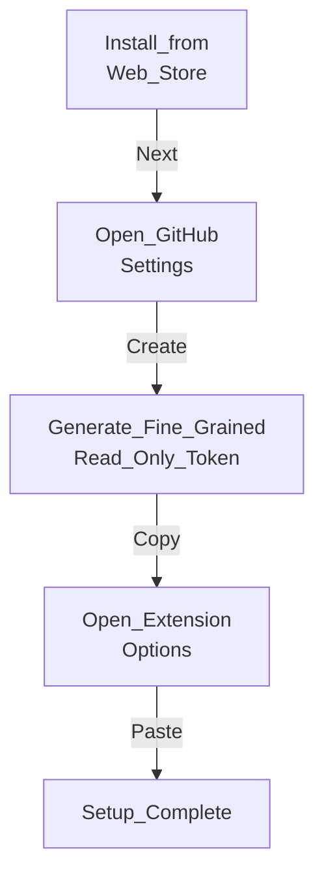
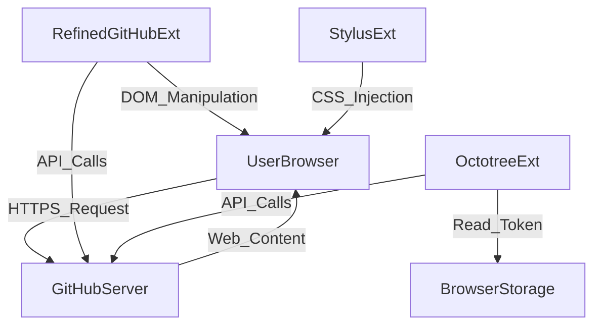

# GitHubのMarkdownをフル幅表示にする手順（Stylus利用）

ブラウザ拡張機能「Stylus」を使用して、GitHub上のMarkdown（READMEやドキュメントなど）の表示幅制限を解除し、画面いっぱいに表示させるためのシンプルな手順書です。EdgeやChromeなど、Chromiumベースのブラウザで誰でも簡単に設定できます。

## 1. 拡張機能のインストール

Chromeウェブストアにアクセスし、「Stylus」をブラウザにインストールします。（Edgeを使用している場合でも、Chromeウェブストアからそのままインストール可能です）

## 2. スタイルの設定フロー

**Procedure_Flowchart:**



上記はStylusをインストールしてから設定を完了するまでの全体的な流れを示す図です。対象ドメインを限定してCSSを保存することで、GitHubのページでのみスタイルが適用されます。

## 3. 適用するCSSコードと詳細手順

**GitHub_FullWidth_CSS:**

```css
/* GitHubのメインコンテナの最大幅制限を解除 */
.container-xl,
.container-lg {
  max-width: 100% !important;
}

/* Markdownのプレビューエリアの最大幅制限を解除 */
.markdown-body {
  max-width: none !important;
}
```

上記はGitHubの標準コンテナ幅およびMarkdownプレビュー領域の最大幅制限（`max-width`）を強制的に解除し、ブラウザの画面幅に対して100%のサイズで描画させるためのCSSコードです。

### 具体的な設定ステップ

1. GitHubのページ（ `[https://github.com/](https://github.com/)` ）を開きます。
2. ブラウザ右上の拡張機能メニューから **Stylusアイコン** をクリックします。
3. メニュー内の「次のスタイルを書く」の下にある **`github.com`** の文字をクリックし、エディタ画面を開きます。
4. 右側の大きなコード入力欄に、上記の **CSSコードをすべて貼り付け** ます。
5. 入力欄の上部（または下部）にある「適用先」が `ドメイン上のURL` : **`github.com`** になっていることを確認します（※ `example.com` になっている場合は手動で書き換えます）。
6. 画面左側の **「保存」** ボタンをクリックします。

以上で完了です。GitHubのページに戻り、ページを再読み込み（F5キー）すると、Markdownが画面幅いっぱいに表示されるようになります。元の表示に戻したい場合は、Stylusアイコンから該当スタイルのチェックを外すだけで簡単に無効化できます。

---

# Refined GitHub 導入・初期設定マニュアル

GitHubの画面UIを改善し、数多くの便利なショートカットを追加するブラウザ拡張機能「Refined GitHub」を、セキュリティを確保した状態（読み取り専用権限）でEdgeブラウザに導入する手順です。

## 1. 拡張機能のインストール

Microsoft EdgeはChromiumベースであるため、Chromeウェブストアから直接インストールが可能です。

1. Edgeブラウザで [Refined GitHub (Chrome ウェブストア)](https://chromewebstore.google.com/detail/refined-github/hlepfoohegkhhmjieoechaddaejaokhf) にアクセスします。
2. 画面右側の青い **「Chrome に追加」** ボタンをクリックします。
3. 確認ポップアップが表示されたら **「拡張機能の追加」** をクリックします。

## 2. 導入の全体フロー

**Refined_GitHub_Setup_Flow:**



プライベートリポジトリを含めたすべての機能を安全に利用するためには、GitHub側で「読み取り専用」の許可証（トークン）を発行し、拡張機能に登録する必要があります。

## 3. 読み取り専用トークン（Fine-grained token）の発行

勝手なコードの書き換えやコミットを防ぐため、最小権限のトークンを作成します。

1. GitHub (`[https://github.com/](https://github.com/)`) にログインし、右上のプロフィールアイコンから **`Settings`** を開きます。
2. 左側メニューの最下部にある **`Developer settings`** をクリックします。
3. 左側メニューから `Personal access tokens` > **`Fine-grained tokens`** を選択し、右上の **`Generate new token`** をクリックします。
4. 設定項目を以下のように指定します：
   - **Token name:** `Refined GitHub Read-Only` など
   - **Expiration:** 任意の期間（例: `90 days`）
   - **Repository access:** **`All repositories`** を選択
5. `Permissions` の中の **`Repository permissions`** を展開し、以下の4つの項目を **`Read-only`** に設定します：
   - **`Contents`**
   - **`Issues`**
   - **`Metadata`** （※他を設定すると自動的に選択されます）
   - **`Pull requests`**
   - _(※他のすべての項目は `No access` のままで構いません)_
6. 画面最下部の緑色の **`Generate token`** ボタンをクリックします。
7. 画面に表示される `github_pat_` から始まる文字列を **コピー** します。（※この画面を閉じると二度と表示されないため注意してください）

## 4. トークンの登録と利用開始

発行したトークンをRefined GitHubに紐付けます。

1. Edgeの画面右上にある「拡張機能」アイコン（ジグソーパズルマーク）をクリックします。
2. 一覧から「Refined GitHub」の横にあるメニュー（`...`）を開き、**「拡張機能のオプション」** をクリックします。
3. 開いた設定画面の `Personal Access Token` （`Token-less usage is not officially supported.` の下の黒い入力欄）に、コピーした **トークンを貼り付けます**。
4. 入力欄の右側に **緑色のチェックマーク（✅）** が表示されれば認証成功です。

以上で設定はすべて完了です。GitHubのリポジトリ画面やIssue画面を開くと、ファイルの最終更新日へのショートカットや、折りたたみ機能などのUI改善が自動的に適用されていることが確認できます。

---

業務でのブラウザ拡張機能の利用について、サイバーセキュリティおよび機密保持の観点から詳細なレポートを作成しました。ご提示いただいた3つの拡張機能は、いずれも世界中の開発者に広く利用されていますが、業務利用においてはデータの流れやトークンの管理方法を正しく理解することが重要です。

以下に各拡張機能の評価と、システムアーキテクチャの図解をまとめました。

### 拡張機能のセキュリティ・機密保持評価レポート

#### 1. Stylus

- **概要:** ユーザーが任意のウェブサイトに対してカスタムCSS（スタイルシート）を適用できる拡張機能です。
- **機密保持・セキュリティ:**
  - **安全性 (高):** ブラウザ内でローカルにCSSを適用するだけであり、外部サーバーへのデータ送信は基本的に行いません。
  - **懸念点:** 外部の不特定多数が作成したテーマ（userstyles.orgなど）をインストールする場合、悪意のあるCSS（背景画像のリクエストを利用したIPアドレスや閲覧ページのトラッキングなど）が含まれるリスクがゼロではありません。
- **業務での利用:** ご自身で数行のCSS（画面幅を100%にする等）を記述して適用する範囲であれば、機密情報の漏洩リスクはなく、極めて安全に利用できます。

#### 2. Refined GitHub

- **概要:** GitHubのUIを改善し、多数の便利なショートカットや機能を追加するオープンソースの拡張機能です。
- **機密保持・セキュリティ:**
  - **安全性 (高):** 完全なオープンソースであり、世界中の開発者によるコード監査の目が入っています。サードパーティのサーバーを介さず、ブラウザから直接GitHubの公式APIと通信します。
  - **懸念点:** プライベートリポジトリで全機能を利用するには、GitHubのPersonal Access Token (PAT) を拡張機能に登録する必要があります。
- **業務での利用:** 企業での利用実績も非常に多く、安全基準は高いです。利用する際は、登録するPATの権限（Scope）を必要最小限（通常は `repo` の読み取り権限のみ）に絞ることでリスクを最小化できます。

#### 3. Octotree

- **概要:** GitHubの画面左側にコードツリーを表示し、IDEのようなファイルナビゲーションを可能にする拡張機能です。
- **機密保持・セキュリティ:**
  - **安全性 (中〜高):** Refined GitHubと同様に、コードツリーを構築するためにGitHubの公式APIを利用します。ソースコードの内容自体を外部サーバーに送信することはありません。
  - **懸念点:** プライベートリポジトリの読み取りにはPATの登録が必要です。トークンはブラウザのローカルストレージに暗号化されずに保存されるため、PC自体のマルウェア感染等には注意が必要です（これは他の多くの拡張機能にも共通します）。
- **業務での利用:** 業務利用として一般的に許容されるレベルです。Pro版（有料）の機能を利用する場合、一部のメタデータがOctotreeのサーバーを経由する可能性があるため、厳密な機密保持要件がある場合は無料版（ブラウザ完結）の範囲で利用するか、社内のセキュリティ部門への確認を推奨します。

---

**title:**



上記は、各ブラウザ拡張機能がユーザーのブラウザおよびGitHubサーバーとどのようにデータ通信を行っているかを示すアーキテクチャ図です。Refined GitHubおよびOctotreeは、ブラウザから直接GitHubのAPIを叩いており、中継サーバーへの機密データの流出がないことがわかります。StylusはブラウザのDOMに対してのみ作用します。

---

総じて、いずれの拡張機能も業務利用の土台に乗る信頼性を持っていますが、会社ごとのセキュリティ基準に照らし合わせる必要が
