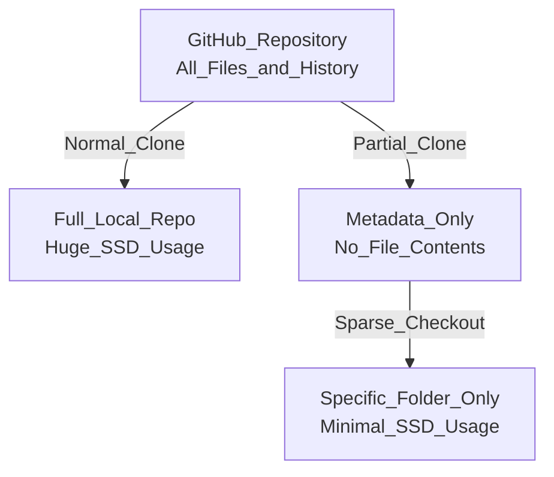

SSDの容量節約、非常に切実で重要なテーマですね。結論から申し上げますと、**リポジトリの全ファイルや重い過去履歴をすべてダウンロードする必要はありません。**

Gitに標準搭載されている**「Sparse Checkout（部分的なチェックアウト）」**と**「Partial Clone（部分的なクローン）」**という2つの最新機能を組み合わせることで、指定した特定のフォルダだけをローカル環境に置き、SSDの消費容量を劇的に抑えることが可能です。

以下にその仕組みと、具体的なコマンド手順を解説します。

### 仕組みの比較図

**title:**



通常の `git clone` が過去の全履歴と全ファイルの中身までまとめてダウンロードするのに対し、この手法では「枠組み（メタデータ）」だけを軽く取得し、後から「必要な特定のフォルダの中身だけ」をピンポイントで取り寄せます。

### 特定フォルダだけをダウンロードする手順

この操作は高度なGit機能を利用するため、VS Codeのターミナルやコマンドプロンプト（CLI環境）を使用して行います。

#### 1. 枠組みだけを軽くクローンする

対象のリポジトリURLを使って、履歴の実体（Blob）を省き、ルート階層のみを展開する設定でクローンします。

```bash
git clone --filter=blob:none --sparse https://github.com/ユーザー名/リポジトリ名.git
```

- `--filter=blob:none` : 過去のファイルの中身をダウンロードせず、メタデータのみを取得します（Partial Clone）。
- `--sparse` : リポジトリ直下のファイルのみを配置し、巨大なサブフォルダ群を展開しません（Sparse Checkoutの初期化）。

#### 2. リポジトリのディレクトリに移動する

ダウンロードされたリポジトリのフォルダに入ります。

```bash
cd リポジトリ名
```

#### 3. 欲しいフォルダを指定して取り寄せる

ローカルに置きたい特定のフォルダのパス（リポジトリのルートからの相対パス）を指定します。

```bash
git sparse-checkout set 取得したいフォルダのパス
```

_(例: `docs/reports-ja` というフォルダだけが欲しい場合は `git sparse-checkout set docs/reports-ja` と入力します)_

#### 4. （任意）後からフォルダを追加する

作業が進み、別のフォルダもローカルに置きたくなった場合は、`add` コマンドで追加ダウンロードが可能です。

```bash
git sparse-checkout add 追加したい別のフォルダパス
```

### 運用上の注意点

- **GUIツールの制約:** GitHub DesktopなどのGUIツールは、現在この「部分的なクローン」を画面上から設定する機能を標準サポートしていません。最初のセットアップは必ずCLIで行う必要があります。
- **普段の作業:** 一度CLIでこの設定をしてしまえば、以後の `git pull` や `git commit`, `git push` 等の操作は通常通り行えます。常に指定したフォルダのみが同期・更新され続けるため、SSDの容量を圧迫することなく安全に作業を継続できます。SSDの容量節約、非常に切実で重要なテーマですね。結論から申し上げますと、**リポジトリの全ファイルや重い過去履歴をすべてダウンロードする必要はありません。**

Gitに標準搭載されている**「Sparse Checkout（部分的なチェックアウト）」**と**「Partial Clone（部分的なクローン）」**という2つの最新機能を組み合わせることで、指定した特定のフォルダだけをローカル環境に置き、SSDの消費容量を劇的に抑えることが可能です。

以下にその仕組みと、具体的なコマンド手順を解説します。

### 仕組みの比較図

**title:**


通常の `git clone` が過去の全履歴と全ファイルの中身までまとめてダウンロードするのに対し、この手法では「枠組み（メタデータ）」だけを軽く取得し、後から「必要な特定のフォルダの中身だけ」をピンポイントで取り寄せます。

### 特定フォルダだけをダウンロードする手順

この操作は高度なGit機能を利用するため、VS Codeのターミナルやコマンドプロンプト（CLI環境）を使用して行います。

#### 1. 枠組みだけを軽くクローンする

対象のリポジトリURLを使って、履歴の実体（Blob）を省き、ルート階層のみを展開する設定でクローンします。

```bash
git clone --filter=blob:none --sparse https://github.com/ユーザー名/リポジトリ名.git
```

- `--filter=blob:none` : 過去のファイルの中身をダウンロードせず、メタデータのみを取得します（Partial Clone）。
- `--sparse` : リポジトリ直下のファイルのみを配置し、巨大なサブフォルダ群を展開しません（Sparse Checkoutの初期化）。

#### 2. リポジトリのディレクトリに移動する

ダウンロードされたリポジトリのフォルダに入ります。

```bash
cd リポジトリ名
```

#### 3. 欲しいフォルダを指定して取り寄せる

ローカルに置きたい特定のフォルダのパス（リポジトリのルートからの相対パス）を指定します。

```bash
git sparse-checkout set 取得したいフォルダのパス
```

_(例: `docs/reports-ja` というフォルダだけが欲しい場合は `git sparse-checkout set docs/reports-ja` と入力します)_

#### 4. （任意）後からフォルダを追加する

作業が進み、別のフォルダもローカルに置きたくなった場合は、`add` コマンドで追加ダウンロードが可能です。

```bash
git sparse-checkout add 追加したい別のフォルダパス
```

### 運用上の注意点

- **GUIツールの制約:** GitHub DesktopなどのGUIツールは、現在この「部分的なクローン」を画面上から設定する機能を標準サポートしていません。最初のセットアップは必ずCLIで行う必要があります。
- **普段の作業:** 一度CLIでこの設定をしてしまえば、以後の `git pull` や `git commit`, `git push` 等の操作は通常通り行えます。常に指定したフォルダのみが同期・更新され続けるため、SSDの容量を圧迫することなく安全に作業を継続できます。SSDの容量節約、非常に切実で重要なテーマですね。結論から申し上げますと、**リポジトリの全ファイルや重い過去履歴をすべてダウンロードする必要はありません。**

Gitに標準搭載されている**「Sparse Checkout（部分的なチェックアウト）」**と**「Partial Clone（部分的なクローン）」**という2つの最新機能を組み合わせることで、指定した特定のフォルダだけをローカル環境に置き、SSDの消費容量を劇的に抑えることが可能です。

以下にその仕組みと、具体的なコマンド手順を解説します。

### 仕組みの比較図

**title:**


通常の `git clone` が過去の全履歴と全ファイルの中身までまとめてダウンロードするのに対し、この手法では「枠組み（メタデータ）」だけを軽く取得し、後から「必要な特定のフォルダの中身だけ」をピンポイントで取り寄せます。

### 特定フォルダだけをダウンロードする手順

この操作は高度なGit機能を利用するため、VS Codeのターミナルやコマンドプロンプト（CLI環境）を使用して行います。

#### 1. 枠組みだけを軽くクローンする

対象のリポジトリURLを使って、履歴の実体（Blob）を省き、ルート階層のみを展開する設定でクローンします。

```bash
git clone --filter=blob:none --sparse https://github.com/ユーザー名/リポジトリ名.git
```

- `--filter=blob:none` : 過去のファイルの中身をダウンロードせず、メタデータのみを取得します（Partial Clone）。
- `--sparse` : リポジトリ直下のファイルのみを配置し、巨大なサブフォルダ群を展開しません（Sparse Checkoutの初期化）。

#### 2. リポジトリのディレクトリに移動する

ダウンロードされたリポジトリのフォルダに入ります。

```bash
cd リポジトリ名
```

#### 3. 欲しいフォルダを指定して取り寄せる

ローカルに置きたい特定のフォルダのパス（リポジトリのルートからの相対パス）を指定します。

```bash
git sparse-checkout set 取得したいフォルダのパス
```

_(例: `docs/reports-ja` というフォルダだけが欲しい場合は `git sparse-checkout set docs/reports-ja` と入力します)_

#### 4. （任意）後からフォルダを追加する

作業が進み、別のフォルダもローカルに置きたくなった場合は、`add` コマンドで追加ダウンロードが可能です。

```bash
git sparse-checkout add 追加したい別のフォルダパス
```

### 運用上の注意点

- **GUIツールの制約:** GitHub DesktopなどのGUIツールは、現在この「部分的なクローン」を画面上から設定する機能を標準サポートしていません。最初のセットアップは必ずCLIで行う必要があります。
- **普段の作業:** 一度CLIでこの設定をしてしまえば、以後の `git pull` や `git commit`, `git push` 等の操作は通常通り行えます。常に指定したフォルダのみが同期・更新され続けるため、SSDの容量を圧迫することなく安全に作業を継続できます。
-
